# elayeek-ai

This is where I back up random projects and tools I make for myself. It doubles as a Claude Code plugin marketplace to make it easier to sync back to my Claude.

| Plugin | Description |
|---|---|
| [`deslop`](./deslop) | Find AI-authored slop in a change with read-only finder agents, grade each finding with a verifier, then fix the ones you pick |
| [`elayeek-ai`](./elayeek-ai) | A skill framework: workflow skills that load only when a task needs them |

## elayeek-ai skills

| Skill | Use it to |
|---|---|
| `code-implementation-plan` | Write or revise an implementation plan folder from a spec, documents, or the conversation |
| `code-implementation-run` | Run or resume an implementation plan, task by task, to local commits |
| `receiving-review` | Collect, judge, fix, and reply to review comments on a pull request |
| `handoff` | Write a handoff file that a fresh session continues from |
| `fan-out-research` | Answer one research question over a large corpus with several analyst agents |
| `write-skill` | Write or revise a Claude Code skill as a standalone procedure |

## Install

```
/plugin marketplace add elayeek/elayeek-ai
/plugin install deslop@elayeek-ai
/plugin install elayeek-ai@elayeek-ai
```

Outside a session, use `claude plugin marketplace add …` and `claude plugin install …`.

## Update

Run `claude plugin update`. Auto-update is off by default for this marketplace.

To release, raise `version` in the plugin's `.claude-plugin/plugin.json`.

## Use in a team project

Add this to the project's `.claude/settings.json`:

```json
{
  "extraKnownMarketplaces": {
    "elayeek-ai": { "source": { "source": "github", "repo": "elayeek/elayeek-ai" } }
  },
  "enabledPlugins": { "deslop@elayeek-ai": true }
}
```

## Other projects

Not in the marketplace.

- [`inline-review`](./misc/inline-review): a mod that shows a file or a git diff in a side pane and lets you leave inline comments the model can read. It needs Claude Code 2.1.287 or later.

  
